# NextMove


[](https://github.com/RafaelBraga-Kribitz/NextMove/actions/workflows/ci.yml)
[](https://www.python.org/downloads/release/python-3120/)
[](#status)
[](LICENSE)

**Status:** In development · the author built the first release and tested it on simulated data only

A next-best-action engine for e-commerce CRM that knows when to do nothing.

- **Who decides:** a CRM manager at an online retailer.
- **What they choose:** the next action for each customer. The options are a product recommendation, a bundle, a discount, an email now or later, a wait, or nothing.
- **The answer (simulated):** the engine earns **€2,909 more** expected profit than the weekly rules playbook (95% CI €2,785 to €3,042).
- **The main caveat:** all data is simulated. The engine only ties "do nothing" (€0). The models predict purchases weakly (ROC AUC 0.51 to 0.53, where 0.5 is a coin flip).
- **The chart:** expected profit of each policy against doing nothing (below).


**Policy comparison (simulated).** The weekly rules playbook loses €2,909 of expected profit against doing nothing. The engine avoids that loss. The bars show 95% intervals for 1,983 simulated customers over 20 weekly decision rounds, run ID `demo-f8fb25c032`.

## What it does

NextMove is a decision engine for e-commerce CRM (customer relationship management). For each customer and each week, it picks the next action, or no action. It explains each pick in one paragraph that a marketing manager can read.

**The decision.** In this simulated retailer, a CRM team should drop the weekly rules-based contact playbook and blanket discounts. It should use restraint-first targeting instead. Over a 20-week held-out test window, the engine earned more expected profit than the rules-only playbook.

**The numbers (all simulated).**

- The engine earns **+€2,909** against the rules-only playbook (95% CI €2,785 to €3,042, simulated).
- The engine does not beat doing nothing (€0, simulated). It contacts almost no one. Its value here is restraint, not extra revenue.
- 92% of the discounts that "always discount" redeemed went to customers who would have bought anyway (simulated).
- No real customers, revenue or production use sit behind these numbers. The [decision record on simulated data](docs/adr/004-synthetic-decisions-public-data-validation.md) sets this rule.

```bash
uv sync               # Python 3.12 environment
just reproduce        # full seeded pipeline, ~20 min on a laptop -> reports/demo/
just serve            # API + manager demo at http://127.0.0.1:8000/demo
```

Then open [`reports/demo/evaluation/evaluation_report.md`](reports/demo/evaluation/evaluation_report.md).

**Skills demonstrated:** SQL (DuckDB star schema, CTEs, SQL tests) · Python · Power BI
(build kit, DAX measures) · data quality / ETL (contracts, quarantine, gates, lineage) ·
statistics (calibration, bootstrap intervals, uplift error) · experimentation (randomized
A/B/n test, three-way decision gateway).
Domain: e-commerce, customer / CRM analytics, segmentation, KPIs (Kennzahlen), purchase-propensity
forecasting.

## The question it answers

*What should we do next for this customer, including waiting or doing nothing, under margin,
inventory and message-fatigue constraints, with a reason a marketing manager can read?*

Recommendation engines answer "which item?". NextMove ranks a whole action catalog by **expected incremental profit**. That is the extra profit compared with doing nothing. The catalog holds recommendations, bundles, two discount tiers, email now or later, wait and do nothing. Hard business rules first remove every action that the rules do not allow.

## Results

All numbers are simulated. Run ID: `demo-f8fb25c032`.

| Policy | Expected profit vs. doing nothing [95% CI] | Contact rate | Wasted-discount share |
|---|---|---:|---:|
| Decision engine (GBM, selected on validation) | €0 [−€1, €0] | 0.0% | — |
| Always discount | −€465 [−€501, −€430] | 2.6% | 92% |
| Rules-only playbook | −€2,909 [−€3,042, −€2,786] | 17.2% | — |
| Top-seller recommendation | −€4,503 [−€4,637, −€4,377] | 29.4% | — |
| Hindsight oracle (ceiling, not deployable) | €44 [€38, €49] | 1.4% | — |

GBM means gradient-boosted decision trees. The engine uses the GBM model because it earned more profit than the logistic model on the validation window. The wasted-discount share is the share of redeemed discounts that went to customers who would have bought anyway.

- **Engine against the rules playbook (simulated):** the engine wins. The 95% interval lies above zero. The three-way gateway returns **Accept**. A policy change still needs human sign-off, under the [three-levels-of-autonomy decision record](docs/adr/009-three-tier-autonomy.md).
- **The engine does not beat doing nothing (simulated).** The gateway calls it a tie (**Reject**, because the result lies inside the margin of indifference). The hindsight oracle shows why. Even perfect knowledge adds only €44 over doing nothing, because the existing campaign calendar already fatigues these customers.
- **Prediction quality (simulated).** Both models pass the calibration gate (test ECE ≤ 0.01). ECE is the expected calibration error: the gap between predicted and actual purchase rates. Observable features carry weak signal (test ROC AUC about 0.51 to 0.53).
- **Uplift (simulated).** The models get the direction right (sign agreement 88 to 96%). The size is too close to zero. The models predict about −0.8 percentage points where the truth is −2.4 ([uplift error](reports/demo/evaluation/uplift_error.csv), [model cards](reports/demo/evaluation/model_cards/)).

The full report has three axes (decision, prediction, system), a failure analysis and a segment view: [`evaluation_report.md`](reports/demo/evaluation/evaluation_report.md).

## Decision

Use the decision engine in place of the weekly playbook. Keep the hard rules. Send any move towards more contact through the three-way gateway, with human sign-off. Do not add model complexity for this customer base until the contact pressure changes. The measured ceiling is small (€44, simulated).

## See it running

Run `just serve`, then open [`/demo`](http://127.0.0.1:8000/demo). The steps are:

1. Pick a customer.
2. Read the decision and its reason.
3. See which options the rules removed.
4. Override the decision.
5. See the override priced on the evaluation page.

The [demo script](docs/DEMO_SCRIPT.md) has the details. The API reference is at `/docs` ([`openapi.json`](docs/api/openapi.json)).

| Decision card | Override priced in evaluation |
|---|---|
|  |  |

## Start here

| Audience | Start here |
|---|---|
| Recruiter | This page; [demo script](docs/DEMO_SCRIPT.md) |
| Hiring manager | [Evaluation report](reports/demo/evaluation/evaluation_report.md), [scope decision for the first release](docs/adr/011-portfolio-scope-for-hiring-market.md) |
| Analyst / BI | [SQL mart](sql/mart/), [SQL tests](sql/tests/), [Power BI kit](reporting/powerbi/README.md) |
| Technical reviewer | [`docs/ARCHITECTURAL_DIRECTION.md`](docs/ARCHITECTURAL_DIRECTION.md), [`src/nextmove/`](src/nextmove/), [acceptance matrix](docs/ACCEPTANCE_MATRIX.md) |
| Auditor | [`docs/SIMULATOR_ASSUMPTIONS.md`](docs/SIMULATOR_ASSUMPTIONS.md), [`docs/QUALITY_BAR.md`](docs/QUALITY_BAR.md), [decision records](docs/README.md), [`DEBT.md`](DEBT.md) |

Files in `docs/` use short codes. The legend under "Repository structure" explains each code.

## Data

| Tag | Meaning | Applies to |
|---|---|---|
| `SIMULATED` | Generated by the seeded world in `src/nextmove/simulator` | Events, catalog, inventory, ground truth, every result |
| `ILLUSTRATIVE` | Design-time examples in docs | Charter personas, target metrics marked "X reported, not invented" |

The data comes from a simulated fashion-and-home retailer. The `demo` profile has 2,000 customers over 18 months and about 1 million events (views, carts, orders, campaign messages). [`docs/SIMULATOR_ASSUMPTIONS.md`](docs/SIMULATOR_ASSUMPTIONS.md) documents the latent traits and response functions. Events pass schema contracts and semantic data-quality gates. The pipeline quarantines failures and never drops them ([data-quality report](reports/demo/mart/data_quality.md)). This repository holds no client data.

## Known limits

- The decision quality holds **in simulation only**. The simulator is the primary data source and the main credibility risk. Read [`docs/SIMULATOR_ASSUMPTIONS.md`](docs/SIMULATOR_ASSUMPTIONS.md) before you trust any number.
- In this simulated world, restraint is close to optimal. The engine's value lies in avoiding harmful contacts, not in finding new revenue. A world with less campaign pressure could rank actions differently.
- The replay is open-loop. Actions change contact history and fatigue, but not later browsing or stock.
- Uplift is the difference of two predictions. It does not come from a dedicated uplift learner.
- The three-way gateway uses fixed thresholds. They do not adapt to traffic.
- Do not make a production-readiness claim until a real dataset has replaced the simulator. Then rerun a temporal holdout on it.

## How it fits together

```mermaid
%%{init: {"theme":"base","fontFamily":"BKribitz, system-ui, -apple-system, Segoe UI, Helvetica, Arial, sans-serif","themeVariables":{"background":"#E4E6EA","primaryColor":"#DCDEE2","primaryTextColor":"#26282C","primaryBorderColor":"#26282C","secondaryColor":"#E4E6EA","secondaryTextColor":"#26282C","secondaryBorderColor":"#5A5C61","tertiaryColor":"#E4E6EA","tertiaryTextColor":"#26282C","tertiaryBorderColor":"#C2C4CA","lineColor":"#5A5C61","textColor":"#26282C","mainBkg":"#DCDEE2","nodeBorder":"#26282C","clusterBkg":"#E4E6EA","clusterBorder":"#C2C4CA","edgeLabelBackground":"#E4E6EA","titleColor":"#26282C","fontFamily":"BKribitz, system-ui, -apple-system, Segoe UI, Helvetica, Arial, sans-serif","fontSize":"14px"},"flowchart":{"curve":"linear","htmlLabels":true,"padding":8}}}%%
flowchart LR
    sim[Simulator] --> ingest[Ingest + data-quality gates]
    ingest --> feat[Point-in-time features]
    feat --> exp[Randomized A/B/n experiment]
    exp --> models[Calibrated response models]
    models --> engine[Decision engine]
    rules[Hard + soft rules] --> engine
    engine --> explain[Templated explanation]
    engine --> eval[Policy replay + three-way gateway]
    eval --> mart[(DuckDB SQL mart)]
    mart --> bi[Power BI kit + demo]
```



## How it works

1. **Experiment.** A randomized A/B/n test (a test with more than two variants) gives each eligible simulated customer a random allowed action. The log keeps only observable columns.
2. **Models.** Logistic regression and LightGBM (a gradient-boosting library) each run as a bootstrap ensemble, which is many models trained on resampled data. They predict the purchase probability for a given action. The pipeline uses time-based splits and Platt calibration, which aligns predicted and actual rates. A calibration gate fails the pipeline when calibration is poor. Uplift is P(buy | action) − P(buy | none), the difference of two predictions ([decision record on uplift](docs/adr/006-propensity-delta-uplift-approximation.md)).
3. **Decision engine.** The engine starts from the candidate actions. Hard constraints remove actions: discount ceiling, margin floor, low-stock gate and weekly contact cap. The engine then scores each remaining action as expected incremental profit minus soft penalties and an uncertainty penalty. The result is a typed `Decision` with interval, confidence, trace and a one-paragraph reason ([contract](docs/api/decision.schema.json), [style guide](docs/EXPLANATION_STYLE_GUIDE.md)).
4. **Evaluation.** The pipeline replays every policy on the same customers, days and random draws (common random numbers). It adds customer-bootstrap intervals and a hindsight-oracle ceiling. A three-way gateway (accept, reject or delay) judges each promotion ([fixed thresholds](docs/adr/008-static-3wd-thresholds.md), [evaluation design](docs/adr/012-simulated-evaluation-design.md)).
5. **Analytics.** A DuckDB star schema holds `fct_decisions`, `fct_outcomes`, `dim_customer`, `dim_action`, `dim_date` and `dim_policy`. It comes with SQL tests and tables for KPIs, retention cohorts and data quality. The pipeline exports them for Power BI ([`reporting/powerbi/`](reporting/powerbi/README.md)).

## Reproduce and check

Python 3.12, [`uv`](https://docs.astral.sh/uv/), [`just`](https://github.com/casey/just).

```bash
git clone https://github.com/RafaelBraga-Kribitz/NextMove.git && cd NextMove
uv sync
just reproduce            # DVC DAG: simulate → ingest → features → experiment → train → evaluate → mart
just verify-published     # published tables must match byte for byte
just ci                   # ruff, format, import contracts, tests (same as CI)
just coverage             # coverage thresholds
```

CI runs the same checks plus the miniature `ci` profile end to end. Operations: [`docs/RUNBOOK.md`](docs/RUNBOOK.md).

## Stack

| Layer | Tools |
|---|---|
| Language and environment | Python 3.12, uv, just |
| Data and SQL | DuckDB (star-schema mart, SQL tests), Parquet / pyarrow, pandas, pandera |
| Modeling | scikit-learn (logistic regression), LightGBM (gradient boosting, TreeSHAP), MLflow tracking |
| Pipeline and lineage | DVC, content-hash lineage, schema-validated YAML config (pydantic) |
| Serving and demo | FastAPI, uvicorn, OpenAPI |
| Reporting | Power BI build kit (DAX, theme, layout), matplotlib |
| Quality | pytest, hypothesis, ruff, import-linter, GitHub Actions |

## Repository structure

| Path | Responsibility |
|---|---|
| `src/nextmove/` | simulator, ingest, features, models, segmentation, rules, decisions, policies, explain, evaluate, api, mart (+ config, storage) |
| `sql/` | Mart models (`sql/mart/`) and SQL tests (`sql/tests/`) |
| `reports/demo/` | Published, seeded results: evaluation report, model cards, mart exports |
| `reporting/powerbi/` | Power BI build kit (the `.pbix` is built by hand from it) |
| `config/` | Schema-validated configuration: every business number lives here |
| `docs/` | Foundation documents, decision records, runbook, acceptance matrix |
| `tests/` | Unit, integration, leakage, golden |

### Legend: codes in the repository files

| Code | Plain name | Where |
|---|---|---|
| ADR-004 | Simulated data first, public-data validation later | `docs/adr/004-synthetic-decisions-public-data-validation.md` |
| ADR-006 | Uplift as the difference of two predictions | `docs/adr/006-propensity-delta-uplift-approximation.md` |
| ADR-008 | Fixed thresholds for the three-way gateway | `docs/adr/008-static-3wd-thresholds.md` |
| ADR-009 | Three levels of autonomy | `docs/adr/009-three-tier-autonomy.md` |
| ADR-011 | Scope of the first release (thin slice for the hiring market) | `docs/adr/011-portfolio-scope-for-hiring-market.md` |
| ADR-012 | Design of the simulated evaluation | `docs/adr/012-simulated-evaluation-design.md` |
| AC-6, AC-11, AC-12 | Acceptance checks: engine against the rules playbook, published tables reproduce exactly, coverage thresholds | `docs/ACCEPTANCE_MATRIX.md` |
| DEBT-001 to DEBT-005 | Accepted shortcuts: uplift from two predictions, fixed gateway thresholds, single-machine storage, hand-set segmentation weights, open-loop replay | `DEBT.md` |
| M-A to M-F | Build milestones: contracts and baselines, models and segmentation, decision engine and explanation, evaluation, API and mart and reporting, engineering and docs | `docs/STATUS_LOG.md`, `docs/MILESTONES.md` |
| 3WD | Three-way decision: accept, reject or delay | `docs/ARCHITECTURAL_DIRECTION.md` |

## Status

**Status:** In development · 2026-10-15 · all six build milestones are complete in [`docs/STATUS_LOG.md`](docs/STATUS_LOG.md)

The author built the first release and tested it **on simulated data only**. These items do not exist yet:

- results on real customer data
- dynamic thresholds for the three-way gateway
- dedicated uplift learners
- validation on public datasets
- contextual bandits (listed in [`docs/MILESTONES.md`](docs/MILESTONES.md#later-explicitly-out-of-scope-for-this-release-per-adr-011))
- the Power BI `.pbix` file, which the author builds by hand from the kit

## License

Apache-2.0. See [`LICENSE`](LICENSE).

## Author

<table>
  <tr>
    <td width="110">
      
    </td>
    <td>
      <strong>Rafael Braga-Kribitz</strong><br />
      Seiersberg-Pirka, Austria · Portfolio project, 2026<br />
      <a href="https://www.linkedin.com/in/rafaelbragakribitz/">LinkedIn</a>
      ·
      <a href="mailto:rafaelbragakribitz@gmail.com">rafaelbragakribitz@gmail.com</a>
    </td>
  </tr>
</table>
