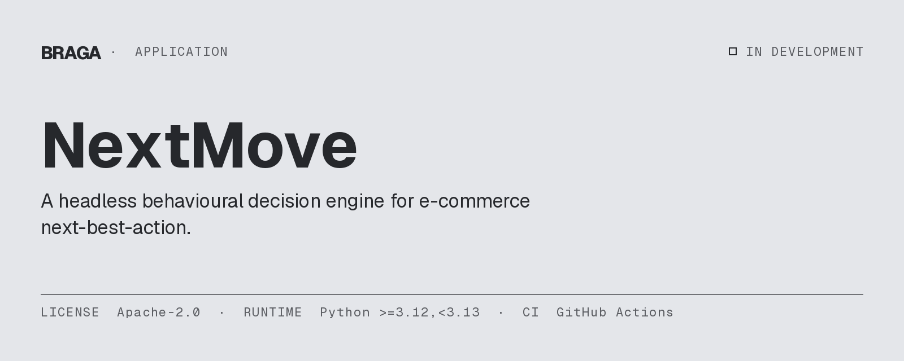
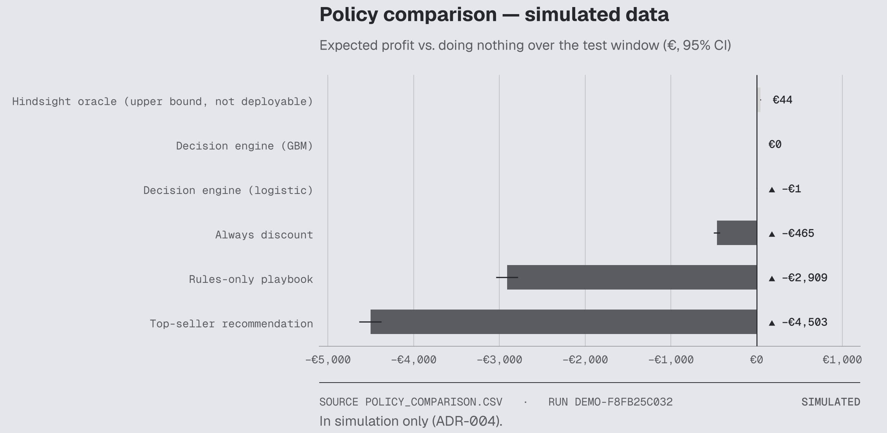
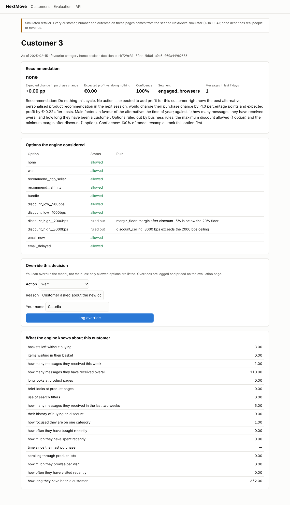
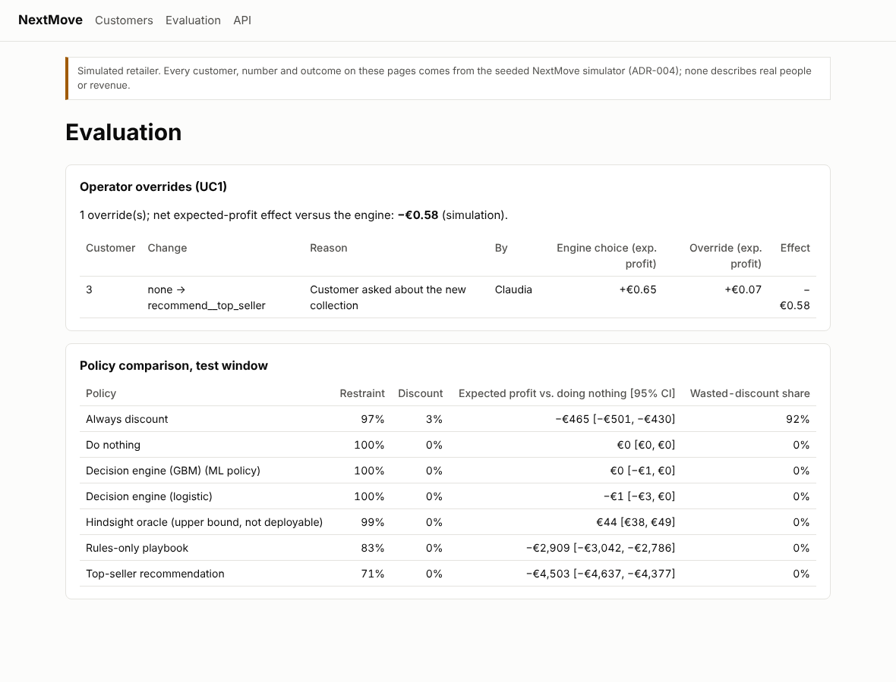

# NextMove



[](https://github.com/RafaelBraga-Kribitz/NextMove/actions/workflows/ci.yml)
[](https://www.python.org/downloads/release/python-3120/)
[](#status)
[](LICENSE)

**Status:** In development · the scoped release (ADR-011) is built and evaluated in simulation only

A next-best-action engine for e-commerce CRM that knows when to do nothing.

## Decision summary

**The decision:** in simulation, a CRM team running this simulated retailer should
**drop the weekly rules-based contact playbook and blanket discounts in favour of
restraint-first targeting**. Over a 20-week held-out test window, the decision engine earned
more expected profit than the rules-only playbook, and 92% of the discounts that
always-discount saw redeemed went to customers who would have bought anyway.



**The number:** the weekly rules-based playbook loses €2,909 of expected profit against doing
nothing, and the decision engine avoids that loss: **+€2,909** versus the rules-only playbook
(95% CI €2,785 to €3,042). The engine does not beat doing nothing (€0; it contacts almost no
one), so its value here is restraint, not extra revenue. 1,983 simulated customers, 20 weekly decision rounds,
run `demo-f8fb25c032`. **In simulation only** (ADR-004): no real customers, revenue or
production use.

```bash
uv sync               # Python 3.12 environment
just reproduce        # full seeded pipeline, ~20 min on a laptop -> reports/demo/
just serve            # API + manager demo at http://127.0.0.1:8000/demo
```

Then open [`reports/demo/evaluation/evaluation_report.md`](reports/demo/evaluation/evaluation_report.md).

**Skills demonstrated:** SQL (DuckDB star schema, CTEs, SQL tests) · Python · Power BI
(build kit, DAX measures) · data quality / ETL (contracts, quarantine, gates, lineage) ·
statistics (calibration, bootstrap intervals, uplift error) · experimentation (randomized
A/B/n test, three-way decision gateway).
Domain: e-commerce, customer / CRM analytics, segmentation, KPIs (Kennzahlen), purchase-propensity
forecasting.

## Question

*What should we do next for this customer, including waiting or doing nothing, under margin,
inventory and message-fatigue constraints, with a reason a marketing manager can read?*

Recommendation engines answer "which item?". NextMove ranks a whole action catalog (recommend,
bundle, two discount tiers, email now or later, wait, do nothing) by **expected incremental
profit** versus doing nothing, after hard business rules have removed what is not allowed.

## Data

| Tag | Meaning | Applies to |
|---|---|---|
| `SIMULATED` | Generated by the seeded world in `src/nextmove/simulator` | Events, catalog, inventory, ground truth, every result |
| `ILLUSTRATIVE` | Design-time examples in docs | Charter personas, target metrics marked "X reported, not invented" |

A simulated fashion-and-home retailer: 2,000 customers over 18 months (the `demo` profile), about
1 million events (views, carts, orders, campaign messages), with documented latent traits and
response functions ([`docs/SIMULATOR_ASSUMPTIONS.md`](docs/SIMULATOR_ASSUMPTIONS.md)). Events
pass schema contracts and semantic data-quality gates; failures are quarantined, never
dropped ([data-quality report](reports/demo/mart/data_quality.md)). No client data is in
this repository.

## Method

```mermaid
%%{init: {"theme":"base","fontFamily":"BKribitz, system-ui, -apple-system, Segoe UI, Helvetica, Arial, sans-serif","themeVariables":{"background":"#E4E6EA","primaryColor":"#DCDEE2","primaryTextColor":"#26282C","primaryBorderColor":"#26282C","secondaryColor":"#E4E6EA","secondaryTextColor":"#26282C","secondaryBorderColor":"#5A5C61","tertiaryColor":"#E4E6EA","tertiaryTextColor":"#26282C","tertiaryBorderColor":"#C2C4CA","lineColor":"#5A5C61","textColor":"#26282C","mainBkg":"#DCDEE2","nodeBorder":"#26282C","clusterBkg":"#E4E6EA","clusterBorder":"#C2C4CA","edgeLabelBackground":"#E4E6EA","titleColor":"#26282C","fontFamily":"BKribitz, system-ui, -apple-system, Segoe UI, Helvetica, Arial, sans-serif","fontSize":"14px"},"flowchart":{"curve":"linear","htmlLabels":true,"padding":8}}}%%
flowchart LR
    sim[Simulator] --> ingest[Ingest + DQ gates]
    ingest --> feat[Point-in-time features]
    feat --> exp[Randomized A/B/n experiment]
    exp --> models[Calibrated response models]
    models --> engine[Decision engine]
    rules[Hard + soft rules] --> engine
    engine --> explain[Templated explanation]
    engine --> eval[Policy replay + 3WD gateway]
    eval --> mart[(DuckDB SQL mart)]
    mart --> bi[Power BI kit + demo]
```



1. **Experiment.** A randomized A/B/n test assigns each eligible simulated customer a random
   allowed action; the log keeps only observable columns.
2. **Models.** Logistic regression and LightGBM, each a bootstrap ensemble, predict purchase
   probability given an action. Temporal splits, Platt calibration, and a calibration gate that
   fails the pipeline. Uplift = P(buy | action) − P(buy | none) (ADR-006).
3. **Decision engine.** Candidates → hard constraints (discount ceiling, margin floor, low-stock
   gate, weekly contact cap) → expected incremental profit minus soft penalties and an
   uncertainty penalty → a typed `Decision` with interval, confidence, trace and a one-paragraph
   reason ([contract](docs/api/decision.schema.json),
   [style guide](docs/EXPLANATION_STYLE_GUIDE.md)).
4. **Evaluation.** Every policy is replayed on the same customers, days and random draws
   (common random numbers), with customer-bootstrap intervals and a hindsight-oracle ceiling.
   A three-way gateway (accept / reject / delay) adjudicates promotions (ADR-008, ADR-012).
5. **Analytics.** A DuckDB star schema (`fct_decisions`, `fct_outcomes`, `dim_customer`,
   `dim_action`, `dim_date`, `dim_policy`) with SQL tests, KPI, retention-cohort and
   data-quality tables, exported for Power BI ([`reporting/powerbi/`](reporting/powerbi/README.md)).

## Result (simulated, run `demo-f8fb25c032`)

| Policy | Expected profit vs. doing nothing [95% CI] | Contact rate | Wasted-discount share |
|---|---|---:|---:|
| Decision engine (GBM, selected on validation) | €0 [−€1, €0] | 0.0% | — |
| Always discount | −€465 [−€501, −€430] | 2.6% | 92% |
| Rules-only playbook | −€2,909 [−€3,042, −€2,786] | 17.2% | — |
| Top-seller recommendation | −€4,503 [−€4,637, −€4,377] | 29.4% | — |
| Hindsight oracle (ceiling, not deployable) | €44 [€38, €49] | 1.4% | — |

- **GBM vs. rule baseline (AC-6):** the engine beats the rules-only playbook with a 95%
  interval above zero; the 3WD gateway returns **Accept**, which for a policy promotion still
  needs human sign-off (ADR-009).
- **The engine does not beat doing nothing**: the gateway calls it a tie (Reject, inside the
  indifference margin). The hindsight oracle shows why: even perfect knowledge adds only €44
  over doing nothing, because the existing campaign calendar already fatigues these customers.
- **Prediction axis:** both models pass the calibration gate (test ECE ≤ 0.01), but observable
  features carry weak signal (test ROC AUC ≈ 0.51–0.53). Uplift is directionally right
  (sign agreement 88–96%) but too close to zero: the models predict about −0.8 pp where the
  truth is −2.4 pp ([uplift error](reports/demo/evaluation/uplift_error.csv),
  [model cards](reports/demo/evaluation/model_cards/)).

Full three-axis report, failure analysis and segment view:
[`evaluation_report.md`](reports/demo/evaluation/evaluation_report.md).

## Limitations

- Decision quality is established **in simulation only**. The simulator is the primary data
  source and the main credibility risk; read
  [`docs/SIMULATOR_ASSUMPTIONS.md`](docs/SIMULATOR_ASSUMPTIONS.md) before trusting any number.
- In this simulated world, restraint is close to optimal, so the engine's value is in avoiding
  harmful contacts, not in finding new revenue. A world with less campaign pressure could
  rank actions differently.
- Replay is open-loop on browsing and stock (DEBT-005); uplift is a difference of two
  predictions, not a dedicated uplift learner (DEBT-001); 3WD thresholds are static (DEBT-002).
- Reconsider any production-readiness claim until a real dataset has replaced the simulator
  and a temporal holdout has been rerun on it.

## Decision

Ship **restraint-first targeting**: use the decision engine in place of the weekly playbook,
keep the hard rules, and route any move towards more contact through the 3WD gateway with
human sign-off. Do not invest in more model complexity for this customer base until the
contact pressure changes: the measured ceiling is small.

## See it running

`just serve`, then [`/demo`](http://127.0.0.1:8000/demo): pick a customer → see the decision
and its reason → see which options the rules removed → override → see the override priced on
the evaluation page ([demo script](docs/DEMO_SCRIPT.md)). API reference at `/docs`
([`openapi.json`](docs/api/openapi.json)).

| Decision card | Override priced in evaluation |
|---|---|
|  |  |

## Explore this project

| Audience | Start here |
|---|---|
| Recruiter | This page; [demo script](docs/DEMO_SCRIPT.md) |
| Hiring manager | [Evaluation report](reports/demo/evaluation/evaluation_report.md), [ADR-011](docs/adr/011-portfolio-scope-for-hiring-market.md) |
| Analyst / BI | [SQL mart](sql/mart/), [SQL tests](sql/tests/), [Power BI kit](reporting/powerbi/README.md) |
| Technical reviewer | [`docs/ARCHITECTURAL_DIRECTION.md`](docs/ARCHITECTURAL_DIRECTION.md), [`src/nextmove/`](src/nextmove/), [acceptance matrix](docs/ACCEPTANCE_MATRIX.md) |
| Auditor | [`docs/SIMULATOR_ASSUMPTIONS.md`](docs/SIMULATOR_ASSUMPTIONS.md), [`docs/QUALITY_BAR.md`](docs/QUALITY_BAR.md), [ADRs](docs/README.md), [`DEBT.md`](DEBT.md) |

## Reproduce and check

Python 3.12, [`uv`](https://docs.astral.sh/uv/), [`just`](https://github.com/casey/just).

```bash
git clone https://github.com/RafaelBraga-Kribitz/NextMove.git && cd NextMove
uv sync
just reproduce            # DVC DAG: simulate → ingest → features → experiment → train → evaluate → mart
just verify-published     # published tables must match byte for byte (AC-11)
just ci                   # ruff, format, import contracts, tests (same as CI)
just coverage             # AC-12 coverage gates
```

CI runs the same checks plus the miniature `ci` profile end to end. Operations:
[`docs/RUNBOOK.md`](docs/RUNBOOK.md).

## Stack

| Layer | Tools |
|---|---|
| Language and environment | Python 3.12, uv, just |
| Data and SQL | DuckDB (star-schema mart, SQL tests), Parquet / pyarrow, pandas, pandera |
| Modeling | scikit-learn (logistic regression), LightGBM (gradient boosting, TreeSHAP), MLflow tracking |
| Pipeline and lineage | DVC, content-hash lineage, schema-validated YAML config (pydantic) |
| Serving and demo | FastAPI, uvicorn, OpenAPI |
| Reporting | Power BI build kit (DAX, theme, layout), matplotlib |
| Quality | pytest, hypothesis, ruff, import-linter, GitHub Actions |

## Repository structure

| Path | Responsibility |
|---|---|
| `src/nextmove/` | simulator, ingest, features, models, segmentation, rules, decisions, policies, explain, evaluate, api, mart (+ config, storage) |
| `sql/` | Mart models (`sql/mart/`) and SQL tests (`sql/tests/`) |
| `reports/demo/` | Published, seeded results: evaluation report, model cards, mart exports |
| `reporting/powerbi/` | Power BI build kit (the `.pbix` is built by hand from it) |
| `config/` | Schema-validated configuration: every business number lives here |
| `docs/` | Foundation documents, ADRs, runbook, acceptance matrix |
| `tests/` | Unit, integration, leakage, golden |

## Status

**Status:** In development · 2026-10-15 · milestones M-A to M-F complete in [`docs/STATUS_LOG.md`](docs/STATUS_LOG.md)

The scoped release (ADR-011) is built and evaluated **in simulation only**. What does not exist
yet: results on real customer data, dynamic 3WD thresholds, dedicated uplift learners,
public-dataset validation and contextual bandits (listed in
[`docs/MILESTONES.md`](docs/MILESTONES.md#later-explicitly-out-of-scope-for-this-release-per-adr-011)),
and the Power BI `.pbix` file, which is built by hand from the kit.

## License

Apache-2.0. See [`LICENSE`](LICENSE).

## Author

<table>
  <tr>
    <td width="110">
      
    </td>
    <td>
      <strong>Rafael Braga-Kribitz</strong><br />
      Seiersberg-Pirka, Austria · Portfolio project, 2026<br />
      <a href="https://www.linkedin.com/in/rafaelbragakribitz/">LinkedIn</a>
      ·
      <a href="mailto:rafaelbragakribitz@gmail.com">rafaelbragakribitz@gmail.com</a>
    </td>
  </tr>
</table>
