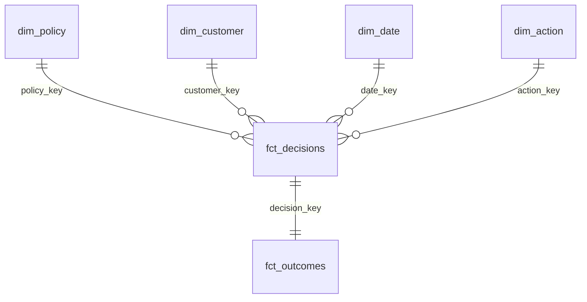

# Data model (star schema)

| From (many) | To (one) | Key | Cross-filter |
|---|---|---|---|
| `fct_decisions[policy_key]` | `dim_policy[policy_key]` | whole number | single |
| `fct_decisions[customer_key]` | `dim_customer[customer_key]` | whole number | single |
| `fct_decisions[date_key]` | `dim_date[date_key]` | whole number (yyyymmdd) | single |
| `fct_decisions[action_key]` | `dim_action[action_key]` | whole number | single |
| `fct_outcomes[decision_key]` | `fct_decisions[decision_key]` | whole number | **both** (1:1) |

`rpt_*` tables and `model_metrics` are disconnected helper tables (no relationships).

## Column types

| Table | Column | Type | Notes |
|---|---|---|---|
| `dim_date` | `calendar_date` | Date | mark as date table |
| `dim_date` | `evaluation_window` | Text | train / validation / test |
| `dim_customer` | `segment_name` | Text | chosen by the MCDA scorecard |
| `dim_customer` | `lifecycle_stage` | Text | joined_during_test / never_bought / active / lapsing / churned |
| `dim_customer` | `fatigue_risk` | Text | low / medium / high (messages in last 14 days) |
| `dim_customer` | `clv_12m_estimate_eur` | Decimal | heuristic, see `sql/mart/04_dim_customer.sql` |
| `dim_policy` | `is_ml_policy` | True/False | the decision engine selected on validation |
| `dim_policy` | `is_reference_only` | True/False | hindsight oracle: hide from slicers |
| `dim_action` | `is_contact`, `is_discount`, `is_restraint` | True/False | |
| `fct_decisions` | `confidence`, `uplift_estimate` | Decimal | blank for rule-based policies |
| `fct_decisions` | `is_overridden` | True/False | operator override logged |
| `fct_outcomes` | `converted`, `would_buy_anyway`, `is_wasted_discount` | True/False | simulation ground truth |
| `fct_outcomes` | `*_eur` | Decimal (currency €) | |

All SQL that builds these tables is in [`../../sql/mart/`](../../sql/mart/), tested by
[`../../sql/tests/`](../../sql/tests/) on every pipeline run.
