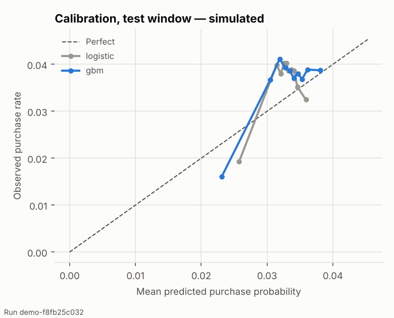

# NextMove evaluation report

> **Simulated data only.** Every number in this file comes from the seeded NextMove simulator (ADR-004); none describes real customers, revenue or production use.

**Run** `demo-f8fb25c032` · profile `demo` · config hash `7c4d3f8e1510` · models `logistic-490a615c10dd`, `gbm-175a0d71539f`

Test window: days 411–548 (20 weekly decision rounds, 1,983 simulated customers). Every policy is replayed on the same customers, days and random draws (common random numbers, ADR-012); intervals are 95% customer-bootstrap intervals.

## Headline

- In simulation, the decision engine (expected_value_gbm) chose to do nothing or wait in 100% of customer-weeks and earned €465 more expected profit than always discounting.
- Always-discount gave a discount in 3% of decisions (the low-stock gate fired in 91% and the weekly contact cap in 64% of its decisions); 92% of its redeemed discounts went to customers who would have bought anyway (€55 of discount spend).
- Against the rules-only playbook the engine's expected profit difference is €2,909 [€2,785, €3,042]; against doing nothing it is €0 [−€1, €0].
- Verdict (AC-6): the learned policy **beats** the rule baseline with a 95% interval above zero. It does not beat doing nothing: in this simulated world restraint is close to optimal, so the engine's value lies in avoiding contacts that cost profit.
- The hindsight oracle, which knows the simulator's true response function, is the ceiling: €44 [€38, €49] over doing nothing.

## Decision axis — policy comparison (AC-10)

| Policy | Decisions | Contact rate | Discount rate | Conversions | Realized profit [95% CI] | Expected profit vs. do nothing [95% CI] | Wasted-discount share | Mean regret (¢) |
|---|---:|---:|---:|---:|---|---|---:|---:|
| Do nothing | 34,423 | 0.0% | 0.0% | 1,366 | €24,798 [€23,561, €26,100] | €0 [€0, €0] | 0% | 0.16 |
| Always discount | 34,423 | 2.6% | 2.6% | 1,345 | €24,312 [€23,056, €25,623] | −€465 [−€501, −€430] | 92% | 1.51 |
| Top-seller recommendation | 34,423 | 29.4% | 0.0% | 1,148 | €20,329 [€19,128, €21,414] | −€4,503 [−€4,637, −€4,377] | 0% | 13.21 |
| Rules-only playbook | 34,423 | 17.2% | 0.0% | 1,223 | €21,910 [€20,739, €23,085] | −€2,909 [−€3,042, −€2,786] | 0% | 8.61 |
| Decision engine (logistic) | 34,423 | 0.1% | 0.0% | 1,366 | €24,797 [€23,560, €26,099] | −€1 [−€3, €0] | 0% | 0.16 |
| Decision engine (GBM) **(ML policy)** | 34,423 | 0.0% | 0.0% | 1,366 | €24,798 [€23,561, €26,100] | €0 [−€1, €0] | 0% | 0.16 |
| Hindsight oracle (upper bound, not deployable) | 34,423 | 1.4% | 0.0% | 1,373 | €24,896 [€23,655, €26,153] | €44 [€38, €49] | 0% | 0.00 |

Regret is the gap, per decision, between the hindsight-best allowed action and the chosen one, in expected profit. *Wasted-discount share*: redeemed discounts whose customer would have bought without one (same random draw, lower probability).

No-incentive rate for would-buy-anyway customers: engine 100%, rules-only 100%, always-discount 98%, do-nothing 100%.

## 3WD gateway verdicts (AC-8)

| Comparison | Profit / decision (¢) [95% CI] | Conversion-rate diff [95% CI] | Verdict | Autonomy | Reason |
|---|---|---|---|---|---|
| expected_value_gbm vs rules_only | +8.392 [+7.089, +9.723] | +0.0042 [+0.0035, +0.0049] | **accept** | requires_human_signoff | CI above zero and effect >= MDE 0.5 |
| expected_value_gbm vs do_nothing | -0.000 [-0.001, +0.000] | +0.0000 [+0.0000, +0.0000] | **reject** | no_change | the confidence interval lies inside the +/-0.25 indifference margin |

Policy promotion is a Tier 2 change (ADR-009): even an Accept needs human sign-off.

## Prediction axis (AC-5)

| Family | Test rows | Brier | Brier skill | ROC AUC | ECE |
|---|---:|---:|---:|---:|---:|
| gbm | 236,552 | 0.03481 | +0.0007 | 0.528 | 0.0046 |
| logistic | 236,552 | 0.03482 | +0.0003 | 0.513 | 0.0055 |

Selected for the decision path: **gbm** (higher realized profit on the validation-window replay: logistic €6,430, gbm €6,447). Model cards: [logistic](model_cards/logistic.md), [gbm](model_cards/gbm.md).

## Uplift approximation error (ADR-006)

Predicted uplift (difference of two response-model predictions) against the simulator's ground-truth uplift, on out-of-time randomized-experiment rows:

| Family | Action | Rows | True uplift (pp) | Predicted (pp) | Bias (pp) | MAE (pp) | Rank corr. | Sign agreement |
|---|---|---:|---:|---:|---:|---:|---:|---:|
| logistic | all | 20,990 | -2.44 | -0.75 | +1.69 | 1.72 | 0.74 | 88% |
| logistic | bundle | 235 | -2.31 | -0.35 | +1.96 | 2.01 | 0.59 | 76% |
| logistic | discount_low | 512 | -2.35 | -0.66 | +1.69 | 1.77 | 0.77 | 96% |
| logistic | email_delayed | 5,043 | -2.55 | -0.96 | +1.58 | 1.63 | 0.70 | 95% |
| logistic | email_now | 5,107 | -2.52 | -0.96 | +1.57 | 1.59 | 0.77 | 91% |
| logistic | recommend | 10,093 | -2.36 | -0.56 | +1.80 | 1.83 | 0.78 | 84% |
| gbm | all | 20,990 | -2.44 | -0.85 | +1.59 | 1.64 | 0.65 | 96% |
| gbm | bundle | 235 | -2.31 | -0.81 | +1.51 | 1.59 | 0.65 | 97% |
| gbm | discount_low | 512 | -2.35 | -0.76 | +1.59 | 1.63 | 0.61 | 98% |
| gbm | email_delayed | 5,043 | -2.55 | -0.95 | +1.60 | 1.62 | 0.66 | 96% |
| gbm | email_now | 5,107 | -2.52 | -0.92 | +1.61 | 1.64 | 0.64 | 96% |
| gbm | recommend | 10,093 | -2.36 | -0.78 | +1.58 | 1.66 | 0.67 | 97% |

## Decision quality and confidence

The engine picked the hindsight-optimal allowed action in 98% of decisions (rules-only 82%, do-nothing 98%). Confidence vs. correctness:

| Confidence bin | Decisions | Mean confidence | Hindsight-optimal share | Mean regret (¢) |
|---|---:|---:|---:|---:|
| [0.0, 0.5) | 58 | 0.21 | 10% | 12.10 |
| [0.5, 0.75) | 28 | 0.55 | 14% | 11.90 |
| [0.75, 0.9) | 195 | 0.86 | 30% | 7.41 |
| [0.9, 1.0) | 34,142 | 1.00 | 99% | 0.09 |

## Segments (AC-7) and the customer view

Segmentation chosen by TOPSIS: **kmeans_k3** among 5 candidates (scorecard: [segmentation_scorecard.json](segmentation_scorecard.json)).

| Segment | Decisions | Engine contact rate | Engine vs. do nothing | Engine vs. always discount | Mean regret (¢) |
|---|---:|---:|---:|---:|---:|
| buyers | 5,500 | 0.0% | €0 | €70 | 0.00 |
| engaged_browsers | 17,080 | 0.0% | €0 | €307 | 0.00 |
| joined_after_snapshot | 8,143 | 0.0% | €0 | €31 | 0.68 |
| occasional_browsers | 3,700 | 0.0% | €0 | €56 | 0.00 |

## System axis

- Decisions replayed: 240,961 across 7 policies; every one passed the `Decision` contract validation.
- Hard-constraint violations: 0 by construction (policies rank survivors only) and by test (AC-2, 10,000 randomized contexts through the engine).
- Human-review escalations in the engine replay: 0.
- Single-decision latency on the build machine: see `runtime.json` (machine-dependent, excluded from the reproducibility guarantee).

## Failure analysis

- **Restraint dominates this world.** The existing campaign calendar already contacts simulated customers about twice a week, and the simulator's fatigue counter never decays, so most extra contact lowers purchase probability. The hindsight oracle itself does nothing in 99% of decisions. Any policy that contacts often (top-seller, always-discount) loses money here.
- **Weak observable signal.** Observable features explain little of the latent traits that drive purchases (test ROC AUC close to 0.5), so the models mainly learn the average direction of each action's effect, not who responds.
- **Uplift is a difference of two noisy predictions** (DEBT-001); see the error table above for its size per action.
- **Worst month for the engine vs. doing nothing:** 2025-02 (€0).
- **Open-loop replay** (DEBT-005): replayed actions change contact history and fatigue but not later browsing or stock.

## Operator overrides (UC1, D4)

No overrides were logged for this run (overrides come from the demo/API).

## Limitations

- All results are in simulation; no claim transfers to real customers without re-validation on real data.
- The outcome is one purchase response at the next visit (ADR-012); longer-run effects (habit, churn) are not modeled.
- MCDA weights are hand-set (DEBT-004); 3WD thresholds are static (DEBT-002).
